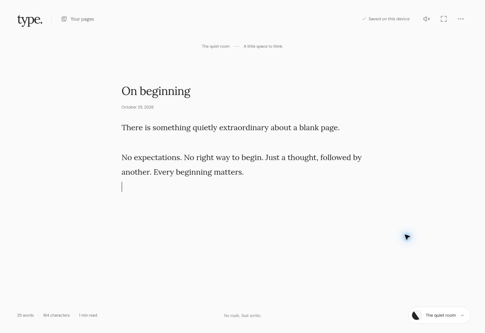
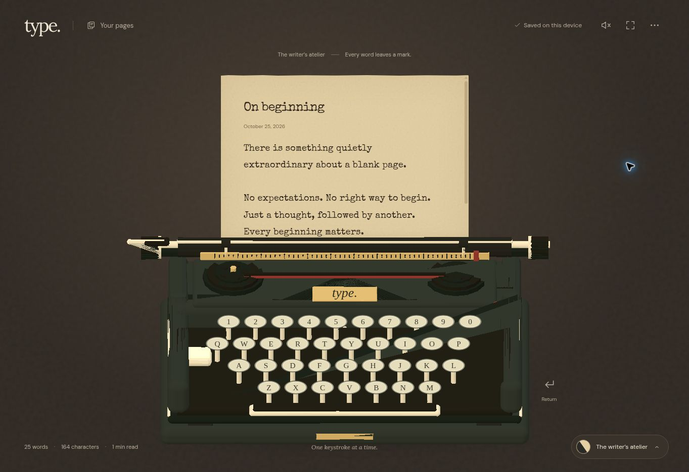

# type.

A quiet place to write. Two rooms, one page.

**The quiet room** pairs an open monochrome canvas with Lora typography, generous line spacing, a native caret and restrained motion. **The writer’s atelier** places the same writing on textured parchment, fed into an original, animated 3D typewriter.

## The rooms

| The quiet room | The writer’s atelier |
| --- | --- |
|  |  |

The atelier screenshot uses the software fallback; WebGL adds physically based lighting and shadows.

## Write

Open the page and start typing. The button in the bottom-right corner changes rooms without replacing the document or its selection.

- Local autosave with multiple named pages and a two-step delete action.
- Plain-text and Markdown import; UTF-8 text download and clipboard copy.
- Live Unicode-aware word counts, character counts and reading time.
- Focus mode, adjustable text size, optional synthesized key sounds and a carriage-return bell.
- Native text editing, selection, undo, spellcheck and Chinese IME input.
- Responsive phone, tablet and desktop layouts, keyboard navigation and reduced-motion support.
- Self-hosted fonts. No analytics, accounts, external assets or writing API.

Your writing is stored in this browser’s local storage. It is not an online backup: clearing site data or changing browsers will not carry your pages over. Use **Download .txt** to keep a copy.

## Keyboard

| Action | Shortcut |
| --- | --- |
| Download current page | Ctrl / ⌘ S |
| New page | Alt N |
| Enter / leave focus | Alt F |
| Close a panel / leave focus | Escape |
| Move between controls | Tab / Shift Tab |
| Move in a menu | Up / Down |

## Develop

Node 22 or newer.

```sh
npm ci
npm run dev
```

```sh
npm test
npm run build
npm run preview
```

Vite builds a completely static site into `dist/`, with relative asset URLs so it can also live under `/type/` on GitHub Pages.

### GitHub Pages

The workflow runs the build and unit tests on pushes and pull requests. To publish on GitHub Pages, select **Settings → Pages → Source → GitHub Actions**, then run **Build and deploy to GitHub Pages** from the Actions tab. Publication is manual so a new repository does not fail its first check before Pages has been enabled.

### The typewriter

`src/typewriter.ts` builds the object from meshes rather than loading a photograph or a remote model: enamel body, staggered metal-rimmed keys, levers, spools, two-tone ribbon, platen, paper bail, margin scale and return lever. WebGL uses physically based materials, environment lighting and shadows. Keys, hammer, spools and carriage respond to typing. Rendering pauses at rest and in background tabs; reduced-motion mode keeps the model still.

When WebGL2 is unavailable, Three.js’s software SVG renderer projects the same mesh scene. It renders geometry at rest and on resize; inexpensive vector key animations keep typing responsive. This fallback has simpler lighting, and does not animate the individual hammer or ribbon. If neither renderer can initialize, writing remains available with a CSS illustration.

## Design and verification

Art direction follows [Leonxlnx/taste-skill](https://github.com/leonxlnx/taste-skill), using its **Achromatic ledger** application direction. Parchment, typewriter lettering and physical light/shadow deliberately follow the requested vintage theme. See [the design and QA notes](docs/design-and-qa.md).

Fonts: DM Sans, Lora and Special Elite, distributed under the SIL Open Font License; their licenses ship in `public/licenses/`. The model, interface and procedural sound effects are original code. No stock photographs or external 3D assets are used.
